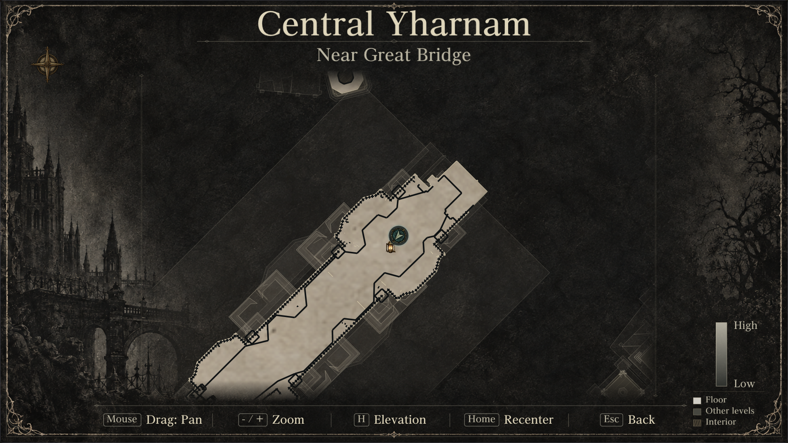
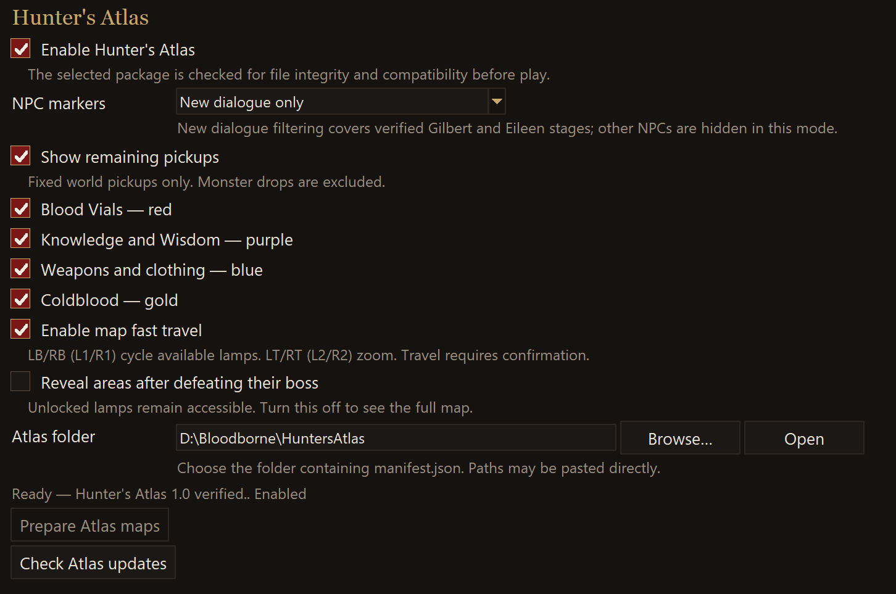

# Hunter’s Atlas 1.3

A fullscreen navigation map for Bloodborne on Windows, with live position,
floor context and 16 supported areas.

**[Download for Windows — player package, about 177 MB](https://github.com/MikeTat1988/HuntersAtlas/releases/download/v1.3/Hunters-Atlas-1.3-Windows.zip)**

[What’s new in 1.3](docs/releases/v1.3.md) ·
[Source ZIP — developers](https://github.com/MikeTat1988/HuntersAtlas/releases/download/v1.3/Hunters-Atlas-1.3-Source.zip)

Atlas now includes its own tested Bloodborne for Windows **1.9 runtime**, Python
and required DLLs. Updates to a separate ordinary launcher cannot replace Atlas
or invalidate its maps. Runtime improvements arrive through tested Atlas updates.
The normal desktop shortcut, launcher interface and native in-game **Map** tile
remain the way to play.

## Features

- Live player position, facing, pan, zoom, recentering and floor context.
- Optional fast travel to discovered lamps, with confirmation. Undiscovered lamps stay hidden.
- Optional pickup dots: red Blood Vials, purple Knowledge/Wisdom, blue equipment and gold Coldblood. Monster drops are excluded.
- Optional map reveal after defeating an area’s boss.
- NPC markers, including a new-dialogue filter for verified Gilbert and early Eileen conversations.
- Prepare maps from your own game files once, then reuse compatible maps across Atlas updates.

Fog, fast travel and pickup categories can be switched off independently in the launcher.
See [controls and coverage](docs/MAP-FEATURES.md).

## Install and play

1. Close the game and launcher. Extract **Hunters-Atlas-1.3-Windows.zip** completely into its own permanent folder outside the game and launcher folders.
2. Run **Install.cmd**. It imports your selected game, DLC, save folder and preferences, and updates the Bloodborne desktop shortcut. Select your original launcher folder if prompted.
3. Open the normal **Bloodborne desktop shortcut**. In **Mods & patches**, ensure **Enable Hunter’s Atlas** is checked, then choose **Play**.
4. Open the game’s quick menu and select **Map**. If compatible prepared maps were not found, Atlas prepares them from your game files on first use.

No system Python, compiler or launcher adapter rebuild is needed. Keep the
extracted Atlas folder in place. Your existing save folder stays selected.
Use a folder your normal Windows account can read and write.
Keep the Atlas package in an ordinary local folder outside OneDrive/synced or
linked folders; the desktop shortcut can still use your redirected Windows Desktop.

Already using Atlas? Extract 1.3 into a **new folder** and run **Install.cmd** to
migrate an older launcher-integrated edition. Keep the old folder until setup
completes so compatible prepared maps can be imported. For updates to this
independent edition, extract the new package elsewhere and run **Update.cmd
from that new extraction**; it finds the installed Atlas and preserves maps and settings.
See [installation](docs/INSTALL.md) and [updates/recovery](docs/LAUNCHER-UPDATES.md).

## Compatibility

Windows 10/11, 64-bit, the verified **CUSA00207 1.09** game build, and hardware/drivers
capable of running the included Windows 1.9 runtime. Other game builds and every
GPU configuration have not been verified. The ordinary launcher’s version no
longer selects or rebuilds the Atlas runtime.

The download is about **177 MB**; the installed package is about **415 MB**, plus
generated caches. Maps and the game font are prepared from your own game files.
No game files, generated maps or saves are distributed. See
[compatibility](docs/COMPATIBILITY.md) and [validation](docs/QA.md).

Travel uses the game’s normal loading/saving and sets the next respawn destination.
**Uninstall.cmd** restores the previous desktop shortcut and retains Atlas files
and maps for recovery.

## Source and credits

[Independent edition build guide](source/owned/SOURCE-BUILD.md) · [Licenses and notices](source/licenses/README.md) ·
[Validation](docs/QA.md)

Built for [Supermedo’s Bloodborne for Windows](https://github.com/Supermedo/bloodborne_pc).
Hunter’s Atlas is an independent community project, unaffiliated with FromSoftware
or Sony Interactive Entertainment.
