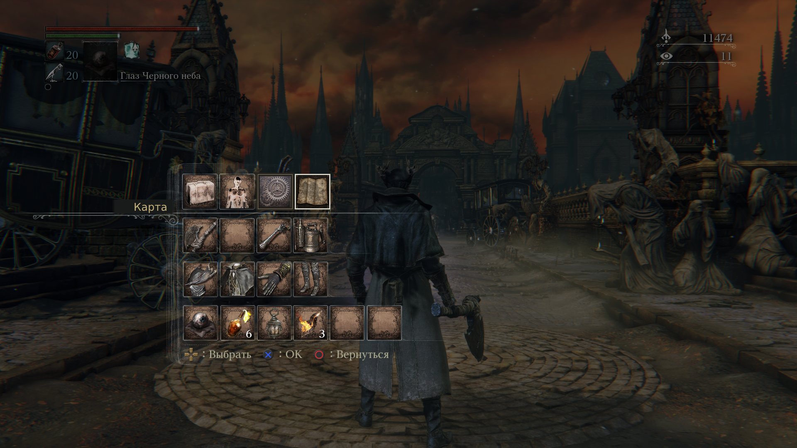
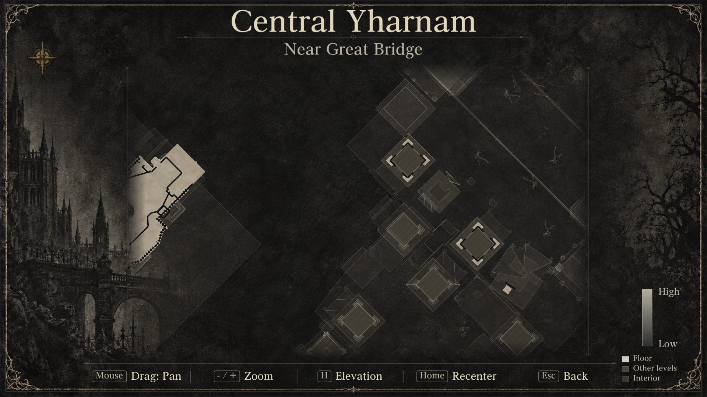
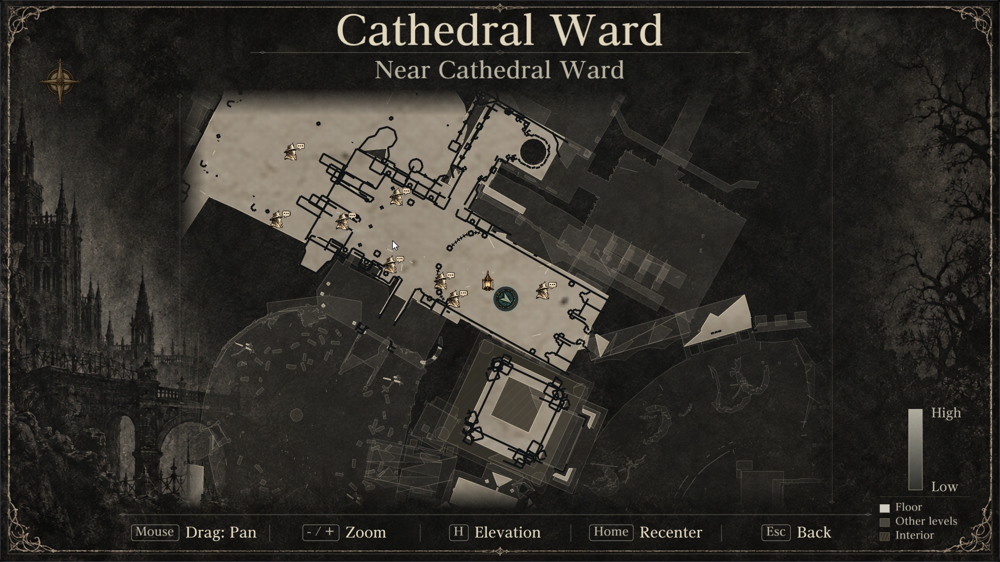
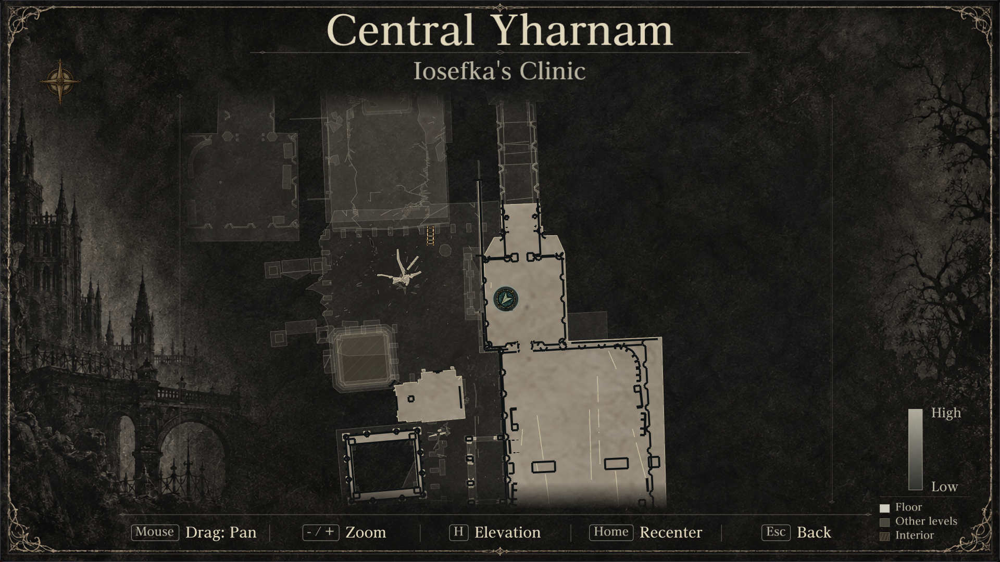
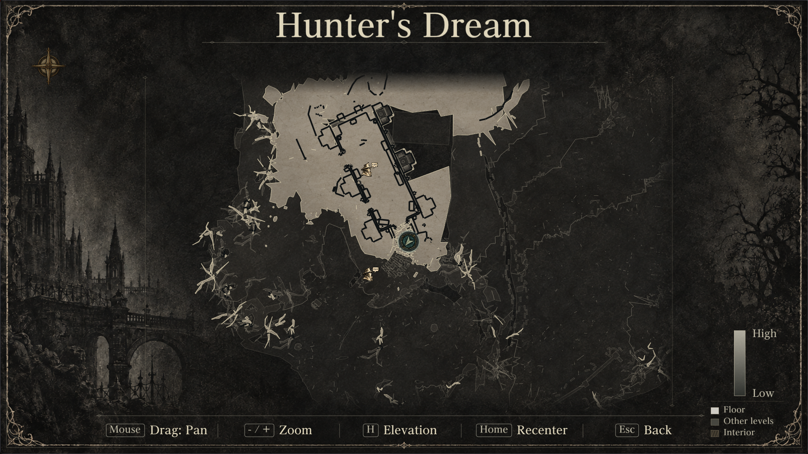
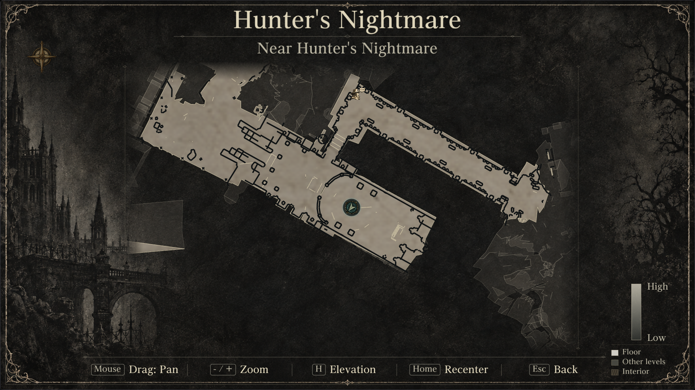
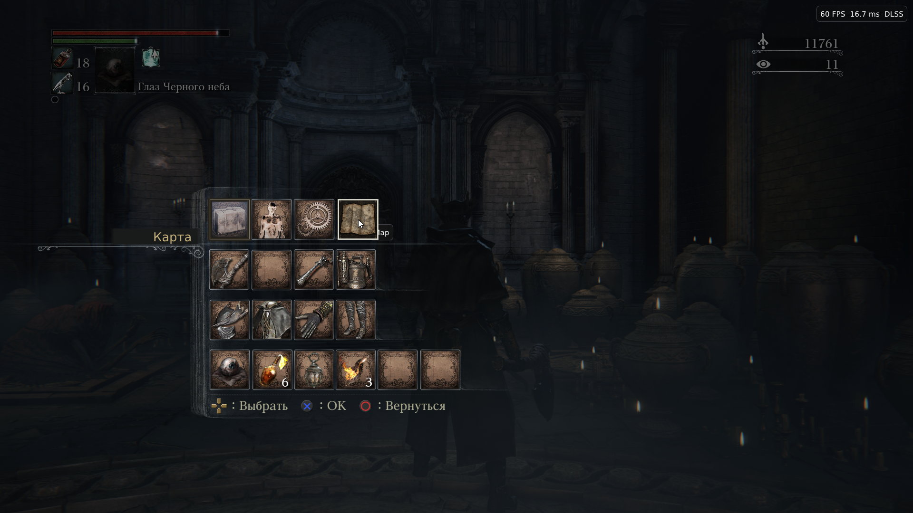

# Hunter’s Atlas 1.0

An in-game map for Bloodborne on PC.

Find your way through Yharnam with a fullscreen map that shows your position, facing direction, and locations of lamps, ladders, gates and NPCs. Explore 16 supported areas across the main game and DLC, with zoom, pan and different floor levels.

First, make sure Bloodborne runs with the [supported PC launcher v1.7.2](https://github.com/Supermedo/bloodborne_pc/releases/tag/windows-v1.7.2).

**Choose your download:**

- **To play:** download [Hunters-Atlas-1.0.zip](https://github.com/MikeTat1988/HuntersAtlas/releases/download/v1.0/Hunters-Atlas-1.0.zip) from Releases (about 300 MB). This is the installable package.
- **To develop:** download [Hunters-Atlas-Source-1.0.zip](https://github.com/MikeTat1988/HuntersAtlas/releases/download/v1.0/Hunters-Atlas-Source-1.0.zip) (about 200 MB) for the complete corresponding source and dependency source. [This repository](https://github.com/MikeTat1988/HuntersAtlas) is also available to browse or clone; **Code → Download ZIP** is about 50 MB and omits the bundled dependency source. Build instructions are in [source/launcher/README.md](source/launcher/README.md).

1. Download the **To play** ZIP above and extract it into a folder you’ll keep.
2. Close the game and launcher. Double-click **Install.cmd** in the extracted folder. When prompted, select your launcher folder — the one containing **Bloodborne.exe**.
3. The installer selects your extracted Atlas folder in the launcher and prepares maps from your game files. Allow about **5–15 minutes**, depending on your PC; the generated maps add approximately **100 MB**.
4. Open the launcher → **Mods & patches** → **Hunter’s Atlas**, check **Enable Hunter’s Atlas**, and click **Play**.

In the game, open the quick menu and select **Map**.

To turn Atlas off, uncheck **Enable Hunter’s Atlas**. To remove its launcher integration, close the game and launcher, then double-click **Uninstall.cmd** in the same extracted folder. It finds the launcher used during installation automatically. Keep the package and original-launcher backup until uninstall completes.

Установка по-русски

1. Для игры скачайте **Hunters-Atlas-1.0.zip** по ссылке выше. Для разработки есть отдельный полный архив **Hunters-Atlas-Source-1.0.zip**. Кнопка **Code → Download ZIP** скачивает только содержимое репозитория.
2. Полностью распакуйте архив в постоянную папку. Закройте игру и лаунчер.
3. Дважды нажмите **Install.cmd**. Укажите папку своего лаунчера, где находится **Bloodborne.exe**. Установщик сам выберет папку Atlas и подготовит карты из файлов игры. Обычно это занимает **5–15 минут** и добавляет около **100 МБ**.
4. Откройте обычный лаунчер → **Mods & patches** → **Hunter’s Atlas**. Включите **Enable Hunter’s Atlas**, нажмите **Play** и выберите **Map** в быстром меню игры.

Для удаления закройте игру и лаунчер и запустите **Uninstall.cmd** из той же распакованной папки. Путь к лаунчеру он определит сам. Установка не требует изменения системной политики PowerShell.

## Example screenshots

| Quick menu | Central Yharnam, Great Bridge |
| --- | --- |
|  |  |

| Scratched tower interiors | Cathedral Ward |
| --- | --- |
|  |  |

| Iosefka’s Clinic | Hunter’s Dream |
| --- | --- |
|  |  |

| Hunter’s Nightmare DLC | Menu navigation |
| --- | --- |
|  |  |

These runtime captures show selected areas, heights and interface states. Some were collected during development; they illustrate the final map layouts. They do not certify every route or supported floor. Human visual review remains separate from technical checks.

## Compatibility and limits

Hunter’s Atlas supports the matching Windows PC launcher v1.7.2 and tested game executable. Installation verifies compatibility before replacing the launcher and retains its original executable for rollback. Game files, saves and personal settings are preserved.

The map supports controller navigation and mouse clicks, pan, zoom, elevation levels, recenter and Back. Other floors remain faintly visible for context, and enclosed spaces use a dark scratched treatment. Marker locations are static: they do not track live quest or gate states. Chalice Dungeons are not supported. Collision-derived floors and inferred interiors can contain omissions.

Map data and the required game font are prepared locally from the user’s own game files; they are not included in the download. Physical controller disconnect and focus-loss behavior still need broader testing. An idle title-screen attract movie can cause a guest fault; its cause remains unresolved.

## Source and licenses

Hunter’s Atlas builds on [Supermedo’s bloodborne_pc](https://github.com/Supermedo/bloodborne_pc). It is an independent community project and is not affiliated with FromSoftware or Sony. Development and original illustrative assets used AI assistance.

The [source repository](https://github.com/MikeTat1988/HuntersAtlas/tree/main/source) contains the implementation and build instructions. The separate [full source download](https://github.com/MikeTat1988/HuntersAtlas/releases/download/v1.0/Hunters-Atlas-Source-1.0.zip) contains corresponding source and dependency source. The native host and Atlas additions retain their GPL notices; see **LICENSE**, source headers and dependency notices. Other components and art retain their respective licenses and provenance.
